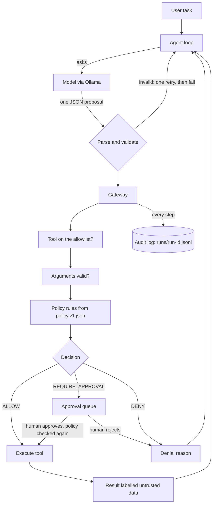

# Architecture

## Boundaries
- `src/model/`: the model client interface and the Ollama implementation. Replaceable.
- `src/agent/`: the loop, the prompt and the proposal parser.
- `src/gateway/`: validation, policy, approvals and the executor. No model calls. A test checks this.
- `src/tools/`: simulated store tools and their Zod schemas.
- `src/audit/`: the log writer and the redaction.
- `eval/`: scenarios, the two runners and the report generator.

Design decisions are in `decisions.md`.